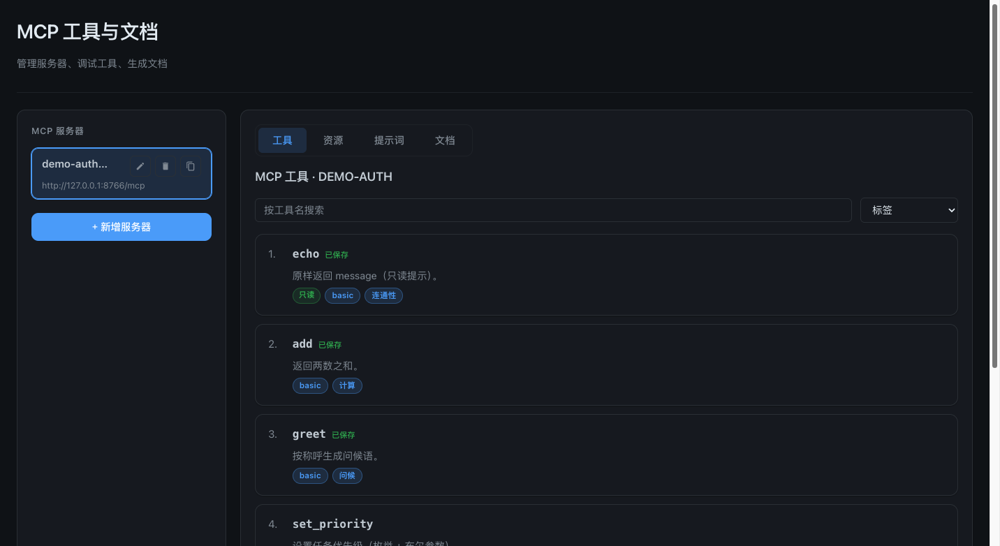
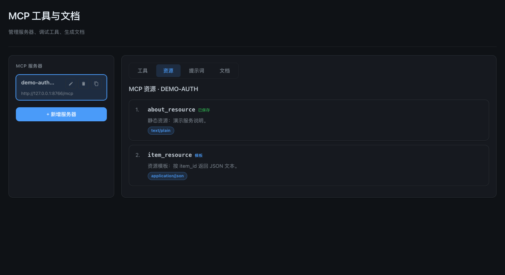
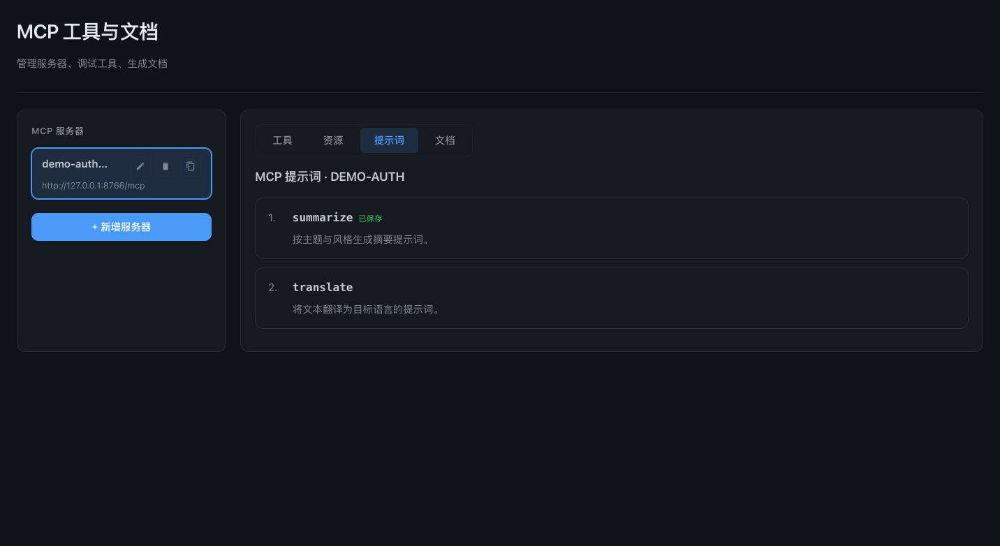
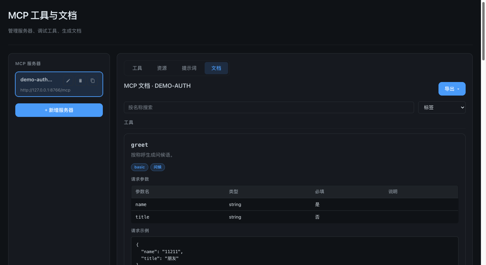

# MCP Doc

连接 MCP 服务，调试 Tools / Resources / Prompts，沉淀文档。

技术栈：FastAPI + React/Vite + SQLite。

## 界面预览

### 工具调试



### 资源



### 提示词



### 文档与导出



## 本地开发

依赖管理使用 [uv](https://docs.astral.sh/uv/)（Python 3.12，虚拟环境位于项目根的 `.venv`）。

镜像源约定（均已在 `pyproject.toml` 中配置）：

| 用途 | 源 |
|------|-----|
| uv 二进制 / Python 解释器下载 | NJU github-release 镜像 |
| Python 依赖包 | 阿里云 PyPI（`mirrors.aliyun.com/pypi/simple/`） |

### 后端

```bash
uv sync          # 创建 .venv 并按 uv.lock 安装依赖
uv run python -m backend.run
```

后端默认监听 **8765**，路径前缀 **/mcp-doc**：页面 `/mcp-doc/`，接口 `/mcp-doc/api`。

业务日志（启动、服务器增删改、连接探测、工具/资源/Prompt 调用与保存清理等）输出到控制台，级别由 `MCP_DOC_LOG_LEVEL` 控制，默认 `INFO`；排查 MCP 连接问题可设为 `DEBUG` 查看会话建立/关闭细节。

### 前端（可选，热更新）

```bash
cd frontend
npm install --registry=https://registry.npmmirror.com
npm run dev
```

开发服务器默认 **5173**，访问 `http://127.0.0.1:5173/mcp-doc/`，`/mcp-doc/api` 代理到后端 8765。

仅跑后端时需先构建前端：

```bash
cd frontend && npm run build
```

## Docker 部署

镜像内 uv 二进制通过 `pip install` 从阿里云 PyPI 安装，依赖同样走阿里源，无需额外配置。

```bash
docker build -t mcp-doc .
docker run -d \
  --name mcp-doc \
  -p 8765:8765 \
  -v /path/to/data:/app/data \
  mcp-doc
```

| 变量 | 说明 | 默认 |
|------|------|------|
| `MCP_DOC_PORT` | 服务端口 | `8765` |
| `MCP_DOC_RELOAD` | 开发热重载 | 关闭 |
| `MCP_DOC_LOG_LEVEL` | 业务日志级别（`DEBUG`/`INFO`/`WARNING`/`ERROR`） | `INFO` |

访问：`http://<主机>:8765/mcp-doc/`

## 能力

- MCP 服务器 CRUD：HTTP（URL + Headers）与 STDIO（command / args / env / cwd）
- 连接探测：延迟与失败原因
- 工具：标签筛选、schema 调试、annotations（read-only / destructive 等）
- 资源：列表 / 模板、按 URI 读取、保存到文档
- 提示词：列表、填参预览 messages、保存到文档
- 文档页与 Markdown / HTML / PDF 导出（工具 + 资源 + 提示词）
- 调用历史：追加时间线（参数 / 结果 / 耗时 / 错误），支持筛选、重放、保存到文档

## 联调服务（可选）

```bash
# HTTP + Bearer
uv run python demo_server/server.py

# STDIO（无 HTTP 鉴权）
uv run python demo_server/stdio_main.py
```

HTTP 默认 `http://127.0.0.1:8766/mcp`，Header：`Authorization: Bearer demo-token`（可用 `DEMO_MCP_TOKEN` 覆盖）。

STDIO 服务器配置示例：command=`python`，args=`["demo_server/stdio_main.py"]`，cwd 为项目根目录。

## 目录

- `backend/` — API 与 MCP 客户端
- `frontend/` — 管理界面
- `demo_server/` — 联调 MCP
- `docs/screenshots/` — README 界面截图
- `data/` — SQLite
- `pyproject.toml` / `uv.lock` — Python 依赖（uv）
- `.python-version` — Python 版本固定（3.12）
